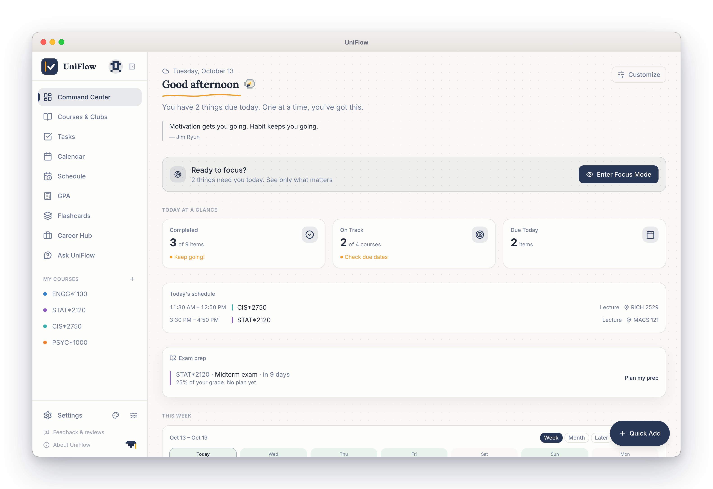

## Tayyab Ahmed

building projects = gaming

**connect**  
[linkedin](https://www.linkedin.com/in/tayyabmahmed/) · [x](https://x.com/tma_exe) · [email](mailto:tahmed06@uoguelph.ca)

---

### 📚 currently shipping → [uniflow](https://uniflow.study)

> drop in your syllabi. get every deadline, exam, and grade weight on one dashboard.  
> built it after missing one too many due dates. now **100+ students** use it.

<a href="https://uniflow.study">
  <picture>
    <source media="(prefers-color-scheme: dark)" srcset="media/uniflow-dashboard-dark-window.png">
    
  </picture>
</a>

  
  
  
  
  

student? it's built for you. go check it out.
